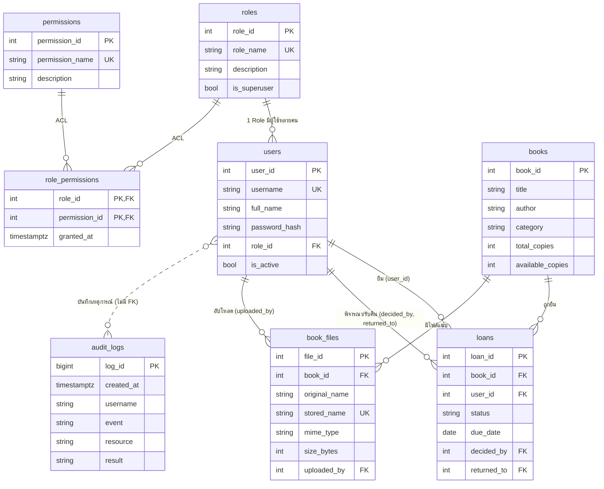

# ระบบยืมคืนหนังสือห้องสมุด (Library System)

เว็บแอปพลิเคชันบริหารจัดการห้องสมุด สำหรับโครงงานเว็บ — Node.js 22+ · Express 5 · PostgreSQL · EJS
(Authentication ด้วย Session + bcrypt, Authorization ด้วย Role × Permission (ACL) ที่จัดการผ่านเว็บ, Audit Log, อัปโหลดไฟล์)

## 1. ติดตั้งและเริ่มใช้งาน

```bash
npm install
# 1) สร้างฐานข้อมูลเปล่าใน psql
psql -U postgres -h localhost -c "CREATE DATABASE library_db;"
# 2) สร้างไฟล์ .env จากตัวอย่าง แล้วแก้ PGPASSWORD และ SESSION_SECRET
cp .env.example .env          # Windows: copy .env.example .env
node -e "console.log(require('crypto').randomBytes(32).toString('hex'))"   # คัดลอกไปใส่ SESSION_SECRET
# 3) สร้างตาราง + ข้อมูลตัวอย่าง (รันซ้ำได้ ข้อมูลเดิมในฐานข้อมูลนี้จะถูกล้าง)
npm run db:init
# 4) เริ่มระบบ
npm start                      # เปิด http://localhost:3000/login
```

ไม่ใช้สคริปต์ก็ได้: `psql -U postgres -h localhost -d library_db -f schema.sql -f seed.sql`

### บัญชีทดสอบ (รหัสผ่านทุกบัญชี = `1234!`)

| username | Role | หน้าที่ |
|---|---|---|
| `admin` | admin | ทำได้ทุกฟังก์ชัน (รวมฟังก์ชัน/Permission ที่เพิ่มภายหลัง) จัดการผู้ใช้ Role Permission ACL |
| `librarian` | librarian | บรรณารักษ์ (ผู้จัดการ): จัดการหนังสือ อนุมัติคำขอ รับคืน จัดการไฟล์ ดู Log |
| `staff` | staff | เจ้าหน้าที่: ดูหนังสือ พิจารณาคำขอ รับคืน อัปโหลดไฟล์ |
| `user` | user | สมาชิก: ค้นหาหนังสือ ส่งคำขอยืม ดู/ยกเลิกคำขอของตนเอง |

> รหัสผ่านถูกเก็บเป็น bcrypt hash (มี salt) ใน `seed.sql` — ไม่มีรหัสผ่านจริงใน Source Code ส่วนฐานข้อมูลตั้งค่าใน `.env` (ส่งเฉพาะ `.env.example`)

## 2. โครงสร้างโปรเจกต์

```
app.js            Express: Session, Login/Logout, ลงทะเบียน Route, error handler
middleware.js     loadUser (โหลดสิทธิ์จาก DB ทุกคำขอ), requireLogin, requirePerm, csrf, flash, validate
lib/audit.js      บันทึก Log ลง PostgreSQL        lib/catalog.js  รายการ Permission ที่มีโค้ดรองรับ
routes/library.js ส่วนผู้ใช้ทั่วไป /app/...  (หนังสือ, คำขอยืม)
routes/files.js   /files/...  อัปโหลด/เปิดดู/ลบไฟล์ (ตรวจสิทธิ์ทุกครั้ง)
routes/admin.js   ส่วน Admin /admin/... (Users, Roles, Permissions, ACL matrix, Logs)
routes/api.js     JSON API  /api/app/...  และ  /api/admin/...
schema.sql  seed.sql  init-db.js     ฐานข้อมูล + ข้อมูลตัวอย่าง
views/  public/style.css  uploads/   หน้าเว็บ / CSS / ที่เก็บไฟล์ (ไม่เปิดเป็น public)
```

## 3. กระบวนการหลัก

`ผู้ใช้ส่งคำขอยืม (pending)` → `เจ้าหน้าที่/บรรณารักษ์ อนุมัติ (approved, ตัดสต็อก, กำหนดวันคืน) หรือ ปฏิเสธ (rejected)` → `รับคืน (returned, คืนสต็อก)`
ผู้ขอยกเลิกได้เมื่อยัง pending (cancelled) · ตรวจสอบสถานะได้ที่ “รายการยืม” และแดชบอร์ด
กฎ: ยืม/รออนุมัติรวมไม่เกิน 3 รายการ, ไม่ขอซ้ำเล่มเดิม, อนุมัติคำขอของตนเองไม่ได้, อนุมัติ/คืนใช้ Transaction + `FOR UPDATE` กันสต็อกติดลบ

## 4. Access Matrix (ตรงกับ ACL เริ่มต้นใน seed.sql)

| ฟังก์ชัน / Permission | admin | librarian | staff | user |
|---|:-:|:-:|:-:|:-:|
| หนังสือ: ดู `books.read` | ✔ | ✔ | ✔ | ✔ |
| หนังสือ: เพิ่ม/แก้ไข/ลบ `books.create/update/delete` | ✔ | ✔ | – | – |
| หนังสือ: Export CSV `books.export` (*ลงทะเบียนผ่านเว็บภายหลัง*) | ✔ | – | – | – |
| คำขอยืม: ส่งคำขอ `loans.create` | ✔ | – | – | ✔ |
| คำขอยืม: ดูของตนเอง `loans.read.own` | ✔ | – | – | ✔ (เฉพาะของตน) |
| คำขอยืม: ดูทั้งหมด `loans.read.all` | ✔ | ✔ | ✔ | – |
| คำขอยืม: ยกเลิกของตน `loans.cancel.own` | ✔ | – | – | ✔ (เฉพาะของตน + pending) |
| คำขอยืม: อนุมัติ/ปฏิเสธ `loans.approve` | ✔ | ✔ | ✔ | – |
| คำขอยืม: รับคืน `loans.return` | ✔ | ✔ | ✔ | – |
| ไฟล์: อัปโหลด `files.upload` | ✔ | ✔ | ✔ | – |
| ไฟล์: เปิดดู/ดาวน์โหลด `files.read` | ✔ | ✔ | ✔ | ✔ |
| ไฟล์: ลบ `files.delete` | ✔ | ✔ | – | – |
| Log: ดูย้อนหลัง `logs.read` | ✔ | ✔ | – | – |
| ผู้ใช้/Role/Permission/ACL `admin.users/roles/permissions/acl` | ✔ | – | – | – |

เงื่อนไขเจ้าของข้อมูล: ผู้ใช้ที่ไม่มี `loans.read.all` เปิดดูได้เฉพาะรายการของตน (ตรวจที่ Server ใน `loadLoan`) และยกเลิกได้เฉพาะคำขอของตนที่ยัง pending
Admin = Role ที่ `is_superuser = TRUE` ผ่านทุกการตรวจสิทธิ์โดยไม่ต้องมีแถวใน ACL จึงใช้ฟังก์ชันที่เพิ่มภายหลังได้ทันที

## 5. ER Diagram



ความสัมพันธ์: User **N–1** Role · Role **N–M** Permission (ผ่าน `role_permissions` = ACL) · Book **1–N** Loan · User **1–N** Loan · Book **1–N** BookFile
ข้อจำกัด: `users.role_id` เป็น FK แบบ RESTRICT (ลบ Role ที่ยังมีผู้ใช้ไม่ได้), `CHECK (available_copies BETWEEN 0 AND total_copies)`, `loans.status CHECK`

## 6. ข้อกำหนดโครงงาน → อยู่ตรงไหน

| ข้อกำหนด | การทำงานในระบบ |
|---|---|
| Authentication | `app.js` Login/Logout ด้วย Session (เก็บใน PostgreSQL), bcrypt hash+salt, ไม่แสดง hash, ไม่บันทึกรหัสผ่านใน Log, regenerate session หลัง login, destroy หลัง logout, ปิดบัญชีแล้วถูกตัด Session ทันที, จำกัดลองรหัสผิด 5 ครั้ง/10 นาที |
| 4 Role + จัดการ Role ผ่านเว็บ | `/admin/roles` เพิ่ม/แก้/ลบ · `/admin/users` กำหนด Role · ลบ Role ที่มีผู้ใช้ไม่ได้ · ห้ามทำให้ไม่เหลือ Admin (เปลี่ยน Role/ปิด/ลบ Admin คนสุดท้ายไม่ได้) |
| Permission + ACL ผ่านเว็บ | `/admin/permissions` และ `/admin/acl` (ตาราง Role × Permission) · `middleware.loadUser` อ่านสิทธิ์จาก DB ทุกคำขอ → เปลี่ยนแล้วมีผลทันทีโดยไม่รีสตาร์ต |
| Permission ใหม่ต้องผูกโค้ด | `lib/catalog.js` + หน้า Permission แสดง “ป้องกันฟังก์ชัน”/เตือน “ยังไม่มีโค้ดตรวจสิทธิ์” · ตัวอย่างที่ผูกแล้ว: `books.export` → `GET /app/books/export.csv` |
| ตรวจสิทธิ์ฝั่ง Server ทุก Route/API | `requirePerm(...)` ทุก Route · API คืน 401/403 เป็น JSON · แยกส่วน `/app` · `/admin` · `/api/admin` |
| อัปโหลดไฟล์/ภาพ | ปกและไฟล์แนบของหนังสือ (`/files/book/:id`) ตรวจ **ชนิดจากเนื้อไฟล์ (magic bytes)** + ขนาด ≤ 3 MB ที่ Server · ชื่อไฟล์สุ่ม UUID · เก็บนอก public · เปิดดู/ดาวน์โหลดผ่าน `/files/:id` ที่ตรวจ `files.read` ทุกครั้ง · เก็บ metadata ใน `book_files` |
| Log + ดูย้อนหลัง | ตาราง `audit_logs` ใน PostgreSQL · `/admin/logs` กรองช่วงวันที่/ผู้ใช้/เหตุการณ์/ผลลัพธ์/ข้อความ + แบ่งหน้า · จำกัดด้วย `logs.read` · บันทึก login สำเร็จ/ล้มเหลว, logout, เพิ่ม/แก้/ลบข้อมูล, เปลี่ยน Role/Permission/ACL, อัปโหลด/ลบไฟล์, การเข้าถึงที่ถูกปฏิเสธ |
| ความปลอดภัยเสริม | CSRF token ทุกฟอร์ม POST, parameterized SQL, EJS escape, ตรวจ input ฝั่ง Server, security headers, CSV formula-injection guard |

## 7. สคริปต์สาธิต (ตรงกับ 9 หลักฐานในโจทย์)

1. **กระบวนการหลัก**: `user` เปิดหนังสือ → ขอยืม → `staff` เข้า “คำขอยืมทั้งหมด” → อนุมัติ → รับคืน → `user` เห็นสถานะ
2. **สิทธิ์ 4 Role**: Login ทีละบัญชี (ใช้ Incognito คนละหน้าต่าง) ดูเมนูที่ต่างกัน
3. **Admin**: `admin` เข้า `/admin/users`, `/admin/roles`, `/admin/acl`
4. **ปฏิเสธ**: `user` พิมพ์ `/admin/users` → 403 · เปิด `/api/admin/users` → 403 JSON · ไม่ Login → 302/401
5. **เพิ่ม Role ใหม่**: `/admin/roles/new` สร้าง `auditor` → `/admin/users` เพิ่มผู้ใช้ให้ Role นี้ (ทดสอบด้วยบัญชีใหม่)
6. **เพิ่ม Permission**: `/admin/permissions` กด “ลงทะเบียน” `books.export` → `/admin/acl` ติ๊กให้ `staff` หรือ `auditor` → บัญชีนั้นเปิด `/app/books/export.csv` ได้ (ปุ่ม Export โผล่ในหน้าหนังสือ)
7. **ยกเลิกสิทธิ์**: เอาติ๊กออกที่ `/admin/acl` → รีเฟรชทันที หน้าเว็บและ `/api/...` ถูกปฏิเสธ โดยไม่รีสตาร์ต Server
8. **ไฟล์**: `staff` อัปโหลดรูปปก (สำเร็จ) → อัปโหลด `.txt` ที่เปลี่ยนนามสกุลเป็น `.png` และไฟล์ > 3 MB (ถูกปฏิเสธ) → `user` เปิดดูภาพได้ แต่ลบไฟล์/อัปโหลดไม่ได้ → ไม่ Login เปิด `/files/1` ไม่ได้
9. **Log**: `librarian` เปิด `/admin/logs` กรอง `role.create`, `acl.grant`, `file.upload`, `access.denied`

## 8. ข้อจำกัดที่ควรพูดตอนนำเสนอ
- ผู้ใช้ 1 คนมี 1 Role (ไม่รองรับหลาย Role ต่อคน) · ไม่มี Refresh/ลืมรหัสผ่าน/ยืนยันอีเมล
- ผู้ที่ได้รับ `admin.acl` แก้สิทธิ์ของ Role ตนเองไม่ได้ และกำหนด Role Admin ไม่ได้ (เฉพาะ Admin)
- ไฟล์เก็บในดิสก์เครื่อง Server (ถ้าใช้งานจริงควรใช้ Object Storage + สแกนไวรัส) · จำกัดการลองรหัสผิดเก็บใน memory (หายเมื่อรีสตาร์ต)
- รันแบบ HTTP บน localhost (ถ้า Deploy ต้องใช้ HTTPS และตั้ง `cookie.secure`)
